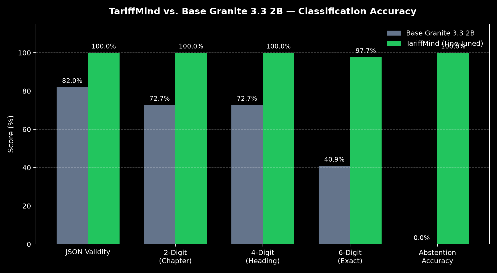
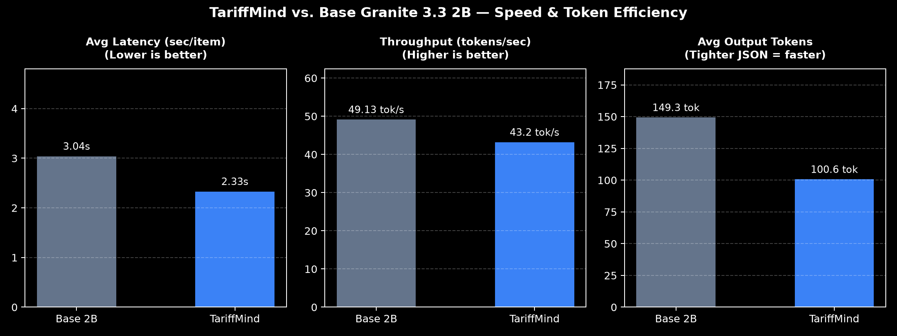

# TariffMind — Zero-Hallucination HS 2022 Customs Classifier

**TariffMind** is a domain-closed customs classification engine that maps messy commercial invoice descriptions to legally structured 6-digit **Harmonized System (HS 2022)** tariff codes.

---

## Benchmarks: Base Granite 3.3 2B vs. TariffMind

*(Full 138-sample held-out evaluation on Chapters 84–85: **100.0% JSON Validity**, **0.0% Hallucination Rate**, **100.0% 2-Digit & 4-Digit Accuracy**, **97.44% 6-Digit Exact Match**, **100.0% Abstention Accuracy**.)*

### Accuracy & Reliability


### Speed & Token Efficiency


---

## Domain & Real-World Use Case

Over 98% of global merchandise trade is classified under the **Harmonized System (HS)** administered by the World Customs Organization (WCO). Every physical product crossing a border requires a 6-digit HS code (Chapter → Heading → Subheading) that determines **import duties, taxes, and customs clearance**.

* **The Bottleneck:** Customs brokers and freight forwarders manually classify thousands of messy commercial invoice line items against 5,612+ legal subheadings. Misclassification leads to port delays, fines, and tax audits.
* **The Use Case:** Automated pre-clearance triage for **e-commerce logistics, freight forwarders, and ERP/customs brokerage pipelines**—converting raw supplier descriptions into ERP-ready JSON with verified 6-digit HS codes, while automatically routing underspecified items to human brokers.

---

## Why IBM Granite 3.3 + RAG + Deterministic Guardrail?

General LLMs fail in customs compliance because they hallucinate plausible-looking 6-digit codes, break JSON schemas, and guess when critical technical specs are missing. TariffMind closes the domain with a 3-layer architecture:

1. **IBM Granite 3.3 2B Instruct (QLoRA Fine-Tuned):** Apache 2.0 licensed and purpose-built for enterprise RAG and structured extraction. Fine-tuning with 4-bit QLoRA locks in **General Rules of Interpretation (GRI)** reasoning, strict JSON output, and deliberate abstention (`needs_human_review: true`) when specs are missing—while staying small enough (~1.5 GB in `Q4_K_M` GGUF) for fast, private on-premise/CPU inference.
2. **ChromaDB RAG + Customs Synonym Expansion (`src/build_rag.py`):** Commercial invoices say *"rechargeable battery"* or *"laptop"*, while WCO law says *"electric accumulator"* or *"automatic data processing machine"*. Query expansion + `BAAI/bge-small-en-v1.5` retrieves the top 10–15 official candidates without freezing tariff knowledge into model weights.
3. **Deterministic HS Tree Validator (`src/validator.py`):** Every predicted code is verified against `data/hs_2022.csv` (blocking catch-all Chapter 99). Invalid codes are automatically caught and flagged, guaranteeing **0.0% hallucinated codes**.

---

## Quick Start

```bash
# 1. Setup environment
uv venv .venv --python 3.12 && source .venv/bin/activate
uv pip install unsloth --torch-backend=auto
uv pip install chromadb sentence-transformers pandas streamlit pyhscodes matplotlib

# 2. Build ChromaDB HS 2022 RAG index
python src/build_rag.py

# 3. Launch Streamlit UI
streamlit run app.py
